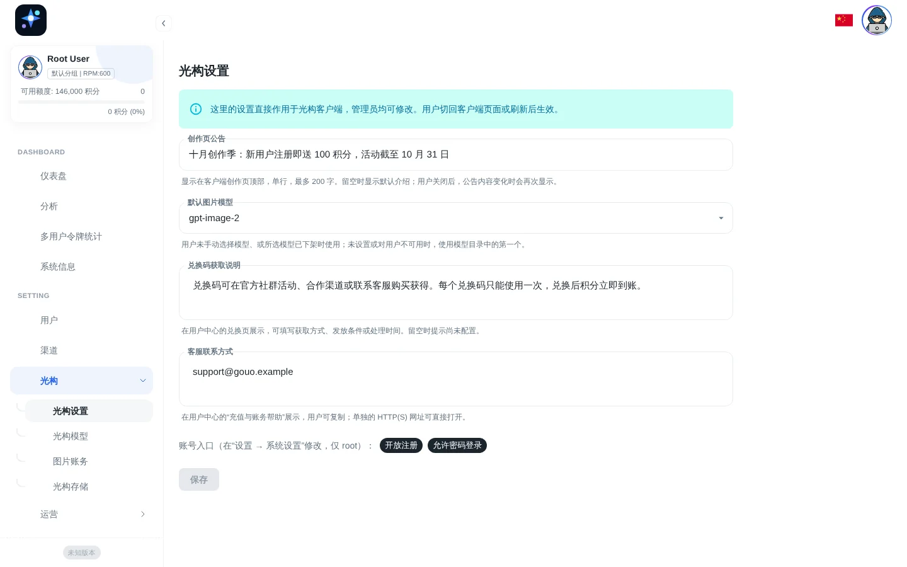
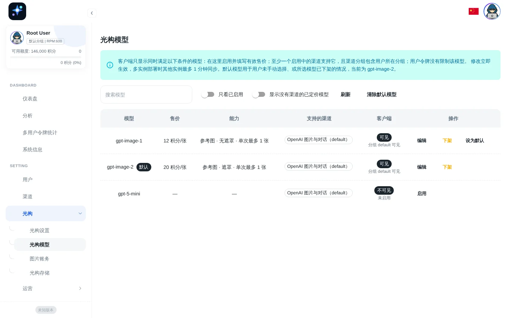
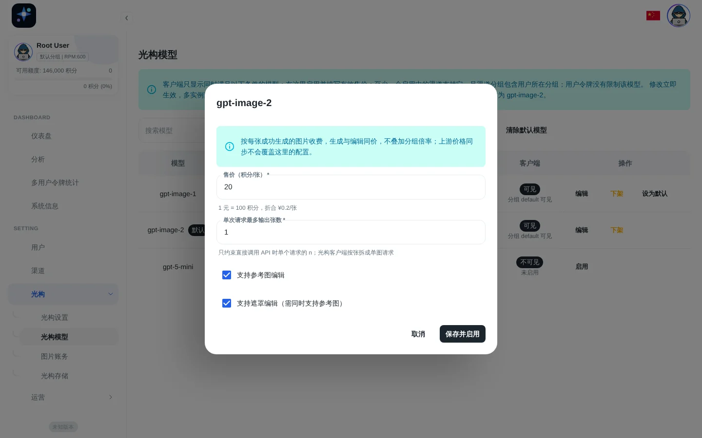
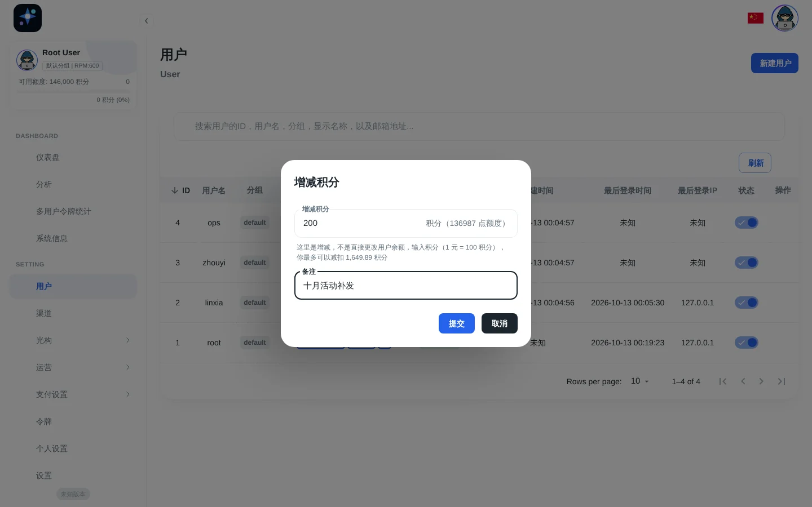
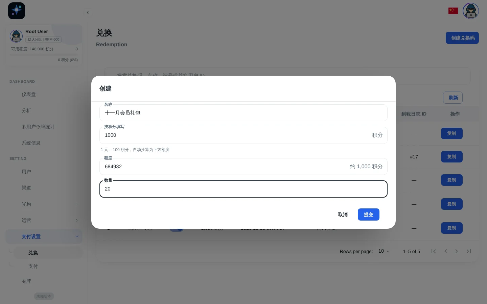
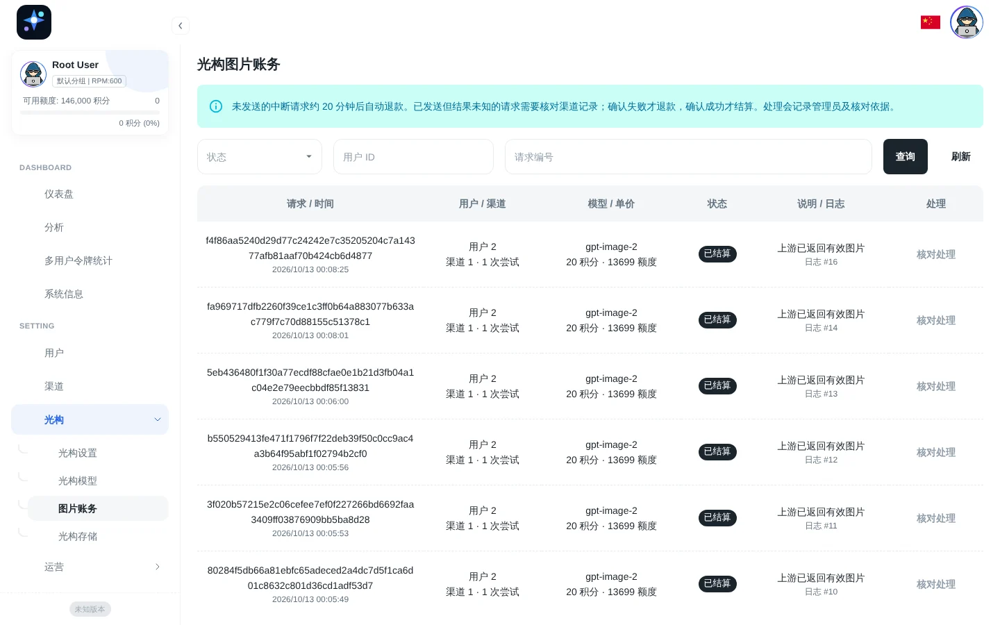
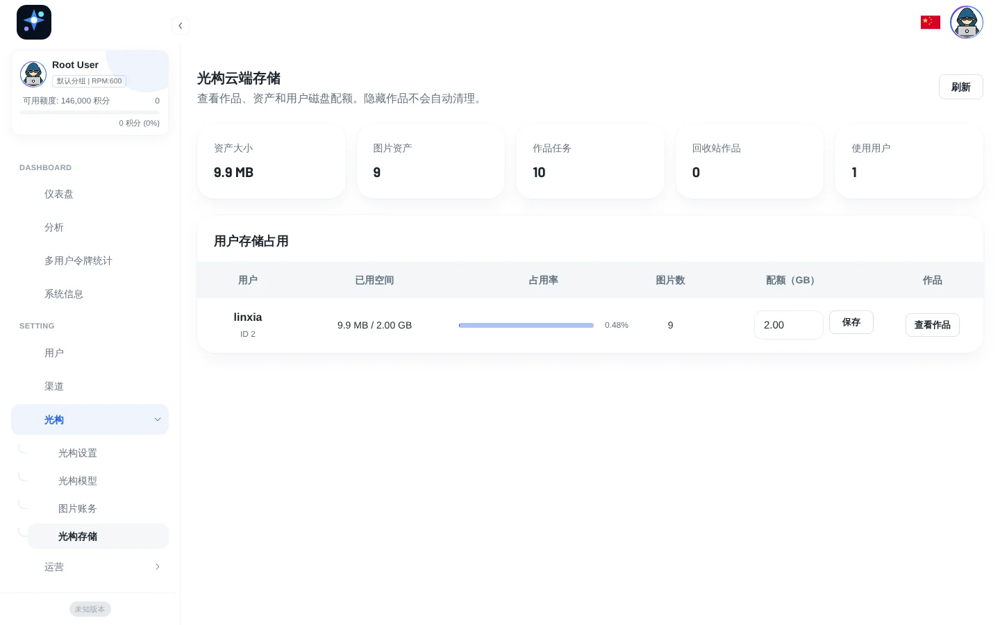
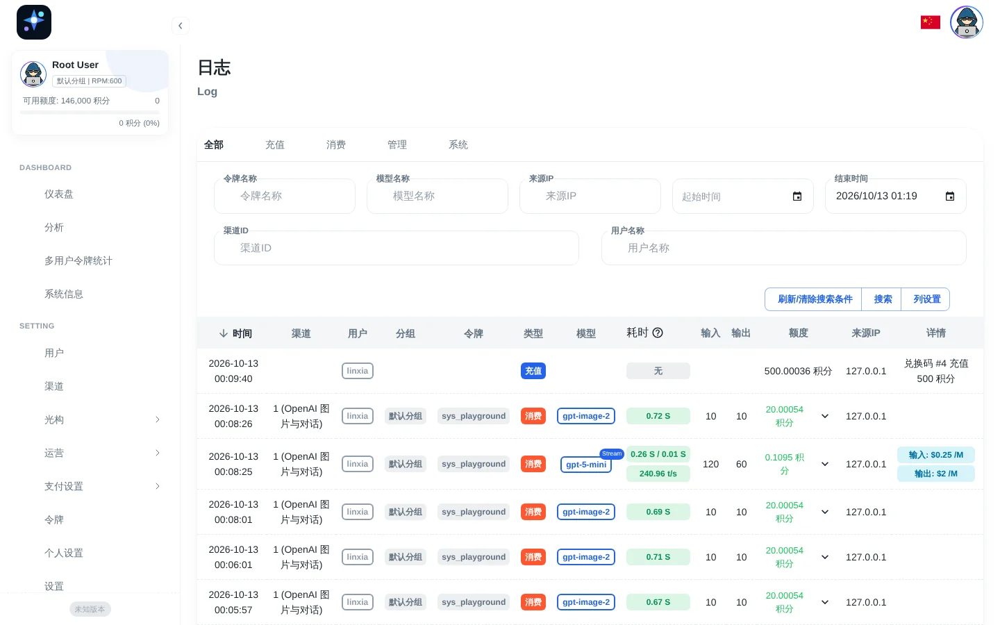

# Gouo Canvas backend integration

[简体中文](../zh-CN/backend.md) · [Documentation index](../README.md)

Gouo Canvas uses a Go service derived from One Hub for accounts, balance, API relay, and the cloud library. `server/` retains upstream licenses, the admin frontend, and general provider capabilities; the public Gouo frontend uses only the product routes that are integrated here.

## 1. Request flow

```text
Register/sign in
  POST /api/user/register
  POST /api/user/login
          ↓ server session cookie
Obtain the user's relay token
  GET /api/token/playground
          ↓ user-scoped token
Read available models and quotes
  GET /api/gouo/models (X-Gouo-Token)
          ↓ model, capabilities, price version
Image request
  POST /v1/images/generations
  POST /v1/images/edits
  POST /v1/images/variations
          ↓
One Hub selects a channel, calls upstream, records usage, and settles balance
```

The browser never receives the platform's upstream API key. It holds only the current user's relay token, limiting exposure to that user's account, permissions, and balance. The token is still sensitive and must not be logged or shared.

## 2. Local integration

Run the backend with SQLite:

```powershell
Set-Location server
$env:SESSION_SECRET = '<at-least-32-random-characters>'
$env:USER_TOKEN_SECRET = '<a-different-at-least-32-character-secret>'
go run .
```

Frontend `.env.local`:

```dotenv
VITE_GOUO_BACKEND_ENABLED=true
VITE_GOUO_BACKEND_URL=
VITE_GOUO_BACKEND_DEV_TARGET=http://127.0.0.1:3000
VITE_GOUO_IMAGE_MODEL=gpt-image-2
```

Local Vite and production Nginx preserve the same routing semantics: `/api` handles accounts and the library; `/v1` handles model relay. Prefer one origin in production. Set `VITE_GOUO_BACKEND_URL` only for an intentional cross-origin design, together with correct cookie, CORS, and HTTPS configuration.

Same-origin sessions default to `HttpOnly; SameSite=Strict`. For a frontend at `https://app.example.com` and a backend on a separate site, build the frontend with `VITE_GOUO_BACKEND_URL=https://api.example.net` and configure the backend:

```dotenv
GOUO_ALLOWED_ORIGINS=https://app.example.com
SESSION_COOKIE_SECURE=true
SESSION_COOKIE_SAME_SITE=none
```

Origins must be exact `http(s)://host[:port]` values, comma-separated, without trailing slashes, paths, or wildcards. Invalid settings prevent startup; `none` requires both Secure and an origin allowlist. The reverse proxy must overwrite and correctly forward `Host` and `X-Forwarded-Proto`, with HTTPS at the browser entry point. Account API credentials are allowed only for listed origins. Cross-site requests without Origin are rejected; in `none` mode, session-bearing requests without Origin also require `Sec-Fetch-Site: same-origin`. Only existing GitHub/Lark/OIDC GET callbacks, which validate session state, are exempt. Browsers that block third-party cookies still require a same-origin proxy. Compose passes these three variables; YAML uses their lowercase equivalents.

The backend rate-limits sign-in, registration and verification emails by client IP and supports per-token IP allowlists. It reads the client IP from `X-Forwarded-For` only for requests coming from `TRUSTED_PROXIES` (`trusted_proxies` in YAML). The default covers loopback and private networks, which fits Nginx on the same host or container network. If the reverse proxy runs at another public address, add its address or CIDR (comma-separated). If the backend faces the internet directly, set it to empty. Behind a platform such as Cloudflare, use `trusted_header` (for example `CF-Connecting-IP`) instead. The backend trusts that header whenever it is present, without checking where the request came from, so the origin must be reachable only through that platform (firewall allows only the platform's ranges, `PUBLIC_PORT` bound to loopback or a private network). Otherwise anyone can connect directly with the header set, spoof their IP, and bypass rate limits and token IP allowlists.

## 3. Admin panel

The backend serves the admin panel at `http://127.0.0.1:3000/panel` by default. An empty database creates `root` / `123456`; change it before any network exposure.

Only administrators can sign in to the admin panel. Regular users are rejected at its login form, a regular user who already has a session is signed out when opening it, and the admin login page has no registration link. Regular users use only the Gouo client. Balances, logs, statistics, charts, and input hints in the panel are shown in points (1 CNY = 100 points); [section 4](#4-model-specific-image-billing) explains the server-side accounting.

Gouo-specific features live under the **光构** (Gouo) menu: 光构设置 (Gouo settings), 光构模型 (Gouo models), 图片账务 (Image billing), and 光构存储 (Gouo storage). The panel interface is Chinese, so English names are given alongside the labels.

> Screenshots come from a local demo environment with demo data.

### 3.1 Gouo settings



**光构设置** collects the settings that act directly on the client. Any administrator can change them (the system-settings API is still root only); they take effect when users return to or reload the client:

- **创作页公告** (announcement): a single line of up to 200 characters at the top of the client's creation page. When blank, the default introduction is shown. A dismissed announcement reappears when its text changes.
- **默认图片模型** (default image model): chosen from enabled models; see [section 4](#4-model-specific-image-billing).
- **兑换码获取说明** (redemption instructions) and **客服联系方式** (support contact): shown on the redemption screen and under "top-up and billing help" in the user center. Both default to blank, and the client says they are not configured yet.
- **开放画布** (canvas) and **开放 Agent** (Agent): when switched off, the client hides the corresponding entry points (the mode switch on the creation page, "My canvases" or "Agent conversations" in the sidebar, and the Agent button inside canvases), and visiting their addresses returns to the creation page. Saved canvases and conversations are kept. With Agent off, the Agent model catalog is empty. The build variables `VITE_CANVAS_ENABLED` and `VITE_AGENT_ENABLED` remain the upper limit: an entry disabled at build time cannot be turned on from the panel.
- **一次最多生成张数** (max images per submission): 1–10. Limits how many images the client submits at once on the creation page, canvas, and Agent; each image is still billed as a single-image request. This is a client submission limit; the images per HTTP request are bounded by each model's "maximum images per request".
- **默认 Agent 模型** (default Agent model): the chat model new conversations start with, chosen from models that qualify for the Agent (step 10 in 3.8). When unset or unavailable to the user, the first model in the catalog is used.
- **Agent 附加提示词** (extra Agent prompt): up to 4000 characters appended after the built-in rules to add tone, brand, or business requirements. It cannot relax the billing confirmation, tool, or safety rules, and applies from the next conversation turn.

The bottom of the page shows whether registration and password sign-in are open. Change them under Settings → System (root only); the client follows them: with registration closed, **免费注册** shows "registration is not open" and the sign-in page hides its registration link; with password sign-in closed, the sign-in page says sign-in is paused.

### 3.2 Gouo models



**光构模型** lists models that are priced or configured on a channel, with their price, capabilities, supporting channels and groups, and whether (and why) clients can see them. Enable, edit, withdraw, set or clear the default model directly here. Models without a channel are hidden until you turn on "显示没有渠道的已定价模型" (show priced models without channels).



The edit dialog takes the price per image in points (with the CNY equivalent shown below), the maximum images per request, and whether reference and mask edits are supported (mask edits require reference support). Withdrawing a model keeps its price. The single-model editor in the price management page offers the same Gouo fields.

### 3.3 Users and points



The user list shows balances and usage in points. **增减积分** (Adjust points) in a user's menu takes the change in points and shows the equivalent quota. Submitting writes a "管理员增减用户积分" (admin adjusted points) log that the user also sees in the client's usage records.

### 3.4 Redemption codes



When creating codes, enter points in **按积分填写** (Enter in points); the quota is calculated automatically and rounded up so the credited balance is never below the entered points, and the quota field shows the approximate points. Up to 100 codes can be created at once; creating several downloads a text file. Redeemed points are credited immediately and logged as "兑换码 #ID 充值 N 积分" (code #ID added N points).

### 3.5 Image billing



**图片账务** lists every image charge with its user, channel, model, unit price (points), status, and log. Interrupted requests that never reached upstream are refunded after about 20 minutes. Requests that were sent but whose outcome is unknown are marked "待核对" (awaiting review); an administrator checks the channel records, records the evidence, and either settles or refunds. See [section 4](#4-model-specific-image-billing).

### 3.6 Gouo storage



**光构存储** shows total assets, image assets, work tasks, works in the recycle bin, and active users, plus each user's usage, share, and quota. You can change one user's quota (not below their current usage) and browse their works. The default quota and asset directory come from environment variables; see [section 5](#5-cloud-library).

### 3.7 Logs



The log page filters by type (top-up, consumption, management, system), user, model, channel, and time, and shows quota in points. Newly written redemption, gift, admin adjustment, online top-up, and task compensation logs also use points in their text.

### 3.8 Recommended first-time setup

1. Create a separate day-to-day administrator account.
2. Add an OpenAI or compatible image channel. Store its API key only in the channel.
3. Configure image models and channel mappings, then enable models in **光构模型** with a price in points, reference/mask support, and an output limit. The client shows the public model ID used in requests; there is no separate display name.
4. In **光构设置**, set the default image model, redemption instructions, and support contact, and publish an announcement if needed.
5. Validate the generations, edits, and variations routes.
6. Validate per-model pricing, successful charges, failure refunds, price-change confirmation, and insufficient-balance rejection.
7. Configure the new-user gift (inputs show the points equivalent), redemption codes, registration policy, and rate limits.
8. If online payment is planned, validate the payment provider, callback signatures, abnormal orders, and reconciliation before exposing it. Payment callbacks are always verified with the gateway's current configuration: to switch merchants (a different app ID, merchant ID, or platform public key), add a new gateway and disable the old one, keeping it until its orders are completed or closed. Otherwise callbacks from the old merchant for orders created before the change fail verification and are not credited.
9. Confirm in **光构存储** that the asset directory is writable, and check user storage.
10. For the Agent, set a text model's info in Model details so that `output_modalities` includes `"text"` and `tags` includes `"tools"` (add `"image"` to `input_modalities` for vision), price it, and give it a channel that supports streaming tool calls.

### 3.9 Registration checks and Turnstile

Registration reads backend status to display email verification and Cloudflare Turnstile. A status failure shows a retry action instead of skipping required verification. Configure `TurnstileCheckEnabled`, `TurnstileSiteKey`, and `TurnstileSecretKey` in the backend and allow the actual frontend hostname in Cloudflare. The public site key enables challenges for registration, verification emails, password-reset emails, and account email binding; the secret stays on the server. Expired or failed challenges can be retried and refresh after submission. Custom CSP must allow scripts and frames from `https://challenges.cloudflare.com`. Tokens are sent to the existing backend Siteverify middleware; a client callback alone is not proof of verification. See [client rendering](https://developers.cloudflare.com/turnstile/get-started/client-side-rendering/) and [server validation](https://developers.cloudflare.com/turnstile/get-started/server-side-validation/). The public Gouo sign-in page has no OAuth entry points.

Turnstile keeps the existing backend session policy: the first successful verification stores `turnstile=true` in the session, and later requests in that session reuse it without another Siteverify call. Refreshing the frontend token after each request does not change this server policy.

In product mode the client does not import service-address parameters such as `apiUrl`/`apiKey` from links or remote config URLs; it only removes them from the address bar.

## 4. Model-specific image billing

Generation, edit, and variation routes charge the public model's CNY selling price per successful HTTP request. The existing `Price` table holds its enabled state, price, capabilities, and output limit. Sizes, quality levels, generation, and editing share one price per model. Group multipliers and upstream model mappings do not change that selling price.

These legacy settings seed the default model only on the first migration. Change later prices in the admin UI:

```dotenv
GOUO_IMAGE_PRICE_CNY=0.10
GOUO_IMAGE_MODEL=gpt-image-2
```

- Users only ever see points (积分): **1 CNY = 100 points**. The client shows balance, unit prices, estimated charges, usage records, and CSV in points; the admin "光构模型" page, price editor, and Gouo billing records take and show prices in points, and the redemption-code dialog and the user "增减积分" (adjust points) dialog accept points and convert them to quota; every other balance, log, statistic, chart, and settings hint in the admin UI is shown in points too. Newly written billing log text (redemption, signup/invite gifts, admin adjustments, online top-ups) and the low-balance email also use points; the client hides legacy log text written in dollars or raw quota and still shows the amount in points. Server-side accounting is unchanged: it still stores CNY prices and converts them to quota with the formula below, so no data migration is needed and existing balances are only displayed in points.
- Migration enables only the previous default model and price, with reference/mask support and an output limit of **1 image**. Increase the limit after checking upstream costs. The limit applies to `n` in a single HTTP request; it does not cap the total images the product client generates, because the client splits them into single-image requests. It preserves balances and historical artworks, never enables other models automatically, and never re-enables a removed or disabled default on restart.
- The models available to clients are managed in 光构 → 光构模型; see [section 3.2](#32-gouo-models).
- The client's default model is set with "设为默认" (Set default) on that page or in 光构 → 光构设置 → "默认图片模型" (Gouo settings → default image model). It is used when the user has not picked a model or the picked model is no longer available; when empty or unavailable to the user, the first model in the catalog is used. Changes apply immediately to users who never picked a model. `VITE_GOUO_IMAGE_MODEL` is only a placeholder until the catalog loads. Manual choices are remembered per account and survive login/token refresh. Tasks and retries retain their original model.
- `GET /api/gouo/models` requires the login cookie and that account's relay token in `X-Gouo-Token`. It intersects enabled models, valid prices, the actual token allowlist, and channels available to its groups. Missing prices and disabled models fail closed instead of falling back to generic pricing.
- The client submits `X-Gouo-Price-Version`. Changed prices or capabilities return `409 image_price_changed`; refresh the catalog and confirm by submitting again. In product mode every retry asks the user to confirm the cost of the new request, showing the new price when it changed. Non-product API tokens may omit the version but still use a quote captured when the request starts.
- Quota is `ceil(CNY price / PaymentUSDRate × QuotaPerUnit)`. Conditional database updates reserve user/token balances in one transaction. Success settles the reservation, confirmed backend failure refunds it, and channel retries share one reservation. Logs preserve the public model, price, billing unit, version, and charged quota. The user center and CSV use the price snapshot; cumulative usage is consumed quota converted at the current rate.
- The Gouo product client splits n images into n single-image requests, and each successful request is charged separately (billed per successful image), up to 10 images at a time. For direct API calls, multiple outputs within the model limit in one HTTP request cost one charge. Frontend compatibility modes can also split a task into separately charged requests.
- Price synchronization and generic batch editing preserve enabled Gouo settings; change them in the single-model editor. Selling prices are independent of upstream costs, so operators must check actual upstream bills.

Image reservations create a durable ledger row in the same transaction. Upstream requests have a 15-minute deadline. At startup and every minute, the primary node refunds unsent reservations older than 20 minutes and marks dispatched requests with unknown outcomes for review. Settlement/refund, balances, statistics, and logs commit atomically; repeated resolution does not repeat the balance change.

Browser timeouts, output downloads, or local storage failures do not mean a refund occurred. Users check image request status in Account → Usage; administrators reconcile upstream records in 光构 → 图片账务 (Image billing) and provide a reason before settling or refunding. Retrying creates a new paid request and does not recover the original result. Back up the database before upgrading. Historical interruptions without ledger rows require manual reconciliation against old logs.

## 5. Cloud library

Primary configuration:

```dotenv
GOUO_CLOUD_LIBRARY_ENABLED=true
GOUO_ASSET_DIR=/data/gouo-assets
GOUO_ASSET_USER_QUOTA_BYTES=2147483648
GOUO_ASSET_MAX_FILE_BYTES=26214400
GOUO_ASSET_MAX_TASK_FILES=32
```

Defaults mean:

- 2 GiB per user.
- 25 MiB per file.
- 32 assets attached to one task.
- SHA-256 deduplication within one user; authorization remains isolated between users.

Successful images are written to the library by the server when they are generated; the browser only submits task metadata, references, and masks, and no longer uploads thumbnails or streaming previews. Canvases and Agent conversations are stored as documents in the database (up to 4 MB each, at most 2000 linked images). Assets are read through authenticated endpoints. Never expose `GOUO_ASSET_DIR` as an Nginx static directory.

The storage quota and the 25 MiB per-file limit apply to user uploads such as references and masks. Paid generated images saved by the server are not limited by the quota (up to 64 MB each), so used storage can exceed the quota. Image results are also cached in `GOUO_ASSET_DIR/image-results` for 24 hours (4 GB total, 256 MB per result) so an interrupted request can recover its original result; include it in capacity and backup planning.

Deleted artworks, canvases, conversations, and collections go to the recycle bin for 3 days. They can be restored during that time and still count toward storage. After that, a cleanup job that runs hourly on the master node permanently deletes the records and any images no longer referenced. Cloud data of deleted accounts is likewise removed after 3 days.

Local-file storage is suitable for one backend instance. Multiple instances must mount the same shared filesystem or database records can point to files visible only on another instance. Gouo-specific object storage is not yet implemented.

## 6. Database, Redis, and backup

- SQLite is acceptable for local development.
- Use MySQL or PostgreSQL for a public production service.
- Multiple instances must share the database, Redis, signing secrets, and asset storage.
- Run exactly one master; set `NODE_TYPE=slave` on the others so scheduled jobs (charge recovery, recycle-bin purge) run once. Model price changes and Gouo model enable/disable reach other instances within one minute; requests made with the old price version in that window get "price updated" and succeed after a page refresh.
- Redis is a cache and coordination layer, not a database backup.
- Back up and restore the database and `GOUO_ASSET_DIR` as one point-in-time set.
- Keep encrypted backups of `SESSION_SECRET`, `USER_TOKEN_SECRET`, and the production environment file.

Restoring only the database leaves library records without images. Restoring only assets leaves files without ownership and task relationships.

## 7. Key routes

| Route | Purpose |
| --- | --- |
| `GET /api/status` | Backend status and client settings (registration and password sign-in switches, announcement, redemption instructions, support contact, email and Turnstile settings) |
| `GET /api/user/self` | Current user, balance (`balance_cny`), and points conversion rate; legacy image_price_cny is not a model quote |
| `GET /api/gouo/models` | Models, prices, capabilities, output limits, and price versions available to the current image token |
| `POST /api/user/login` | Sign in |
| `POST /api/user/register` | Register |
| `GET /api/token/playground` | Current user's image relay token |
| `POST /api/user/topup` | Redeem credit code |
| `GET /api/log/self` | Current user's usage history |
| `GET /api/gouo/storage` | Cloud storage summary |
| `POST /api/gouo/assets` | Upload an account asset |
| `GET /api/gouo/tasks`, `GET /api/gouo/collections` | Cursor-paginated artworks and collections (`hidden=true` for the recycle bin) |
| `PUT /api/gouo/tasks/:clientTaskId` | Create or update a task |
| `PATCH /api/gouo/tasks/:clientTaskId/meta` | Submit metadata for an artwork the server already saved |
| `POST /api/gouo/tasks/:id/hide`, `/restore` | Move an artwork to the recycle bin or restore it |
| `PUT /api/gouo/collections/:id` | Create or update a collection (`/hide` and `/restore` as above) |
| `/api/gouo/canvases[/:id]`, `/api/gouo/conversations[/:id]` | List, read, save, hide, and restore canvas and Agent conversation documents |
| `GET /api/gouo/image-charges` | Current user's image charge records |
| `GET /api/gouo/image-results` | Recover a paid image result by its original request ID |
| `GET /api/gouo/agent/models` | Agent models available to the current user |
| `GET/PUT /api/gouo/admin/settings` | Admins read and write Gouo client settings (announcement, default image model, redemption instructions, support contact) |
| `GET/PUT /api/gouo/admin/models` | Admins view and change Gouo model prices, capabilities, and availability |
| `GET /api/gouo/admin/image-charges`, `POST …/:id/resolve` | Admins review image billing and resolve pending requests |
| `GET /api/gouo/admin/storage[/users…]`, `PUT …/users/:id/quota` | Admins view storage usage, browse a user's works, and change user quotas |

Every user-data endpoint must enforce authentication and ownership on the server. Hiding a frontend control is not authorization.

## 8. Current boundaries

- The public frontend includes sign-in, registration, user center, redemption codes, usage history, cloud library, canvas, and Agent.
- Online payment becomes a production feature only after One Hub configuration and callback, duplicate-notification, failure, and reconciliation testing.
- Product-mode image endpoints currently use non-streaming backend settings; frontend-only mode retains streaming compatibility tests.
- `server/docs/` describes general upstream One Hub features and does not imply that the public Gouo UI exposes every one of them.
