# 光构用户指南

[English](../en/user-guide.md) · [文档中心](../README.md)

本指南面向使用光构公开产品模式的创作者。管理员部署和后台配置请阅读[部署总览](./deployment/index.md)和[后端接入说明](./backend.md)。

> 本文截图来自本地演示环境（2026-10），账号、作品和积分均为演示数据；作品图片是为文档绘制的示意图，不是真实模型输出。

## 1. 注册与登录

未登录时打开光构会进入产品首页，可以从顶栏或首屏进入“免费注册”和“登录”。

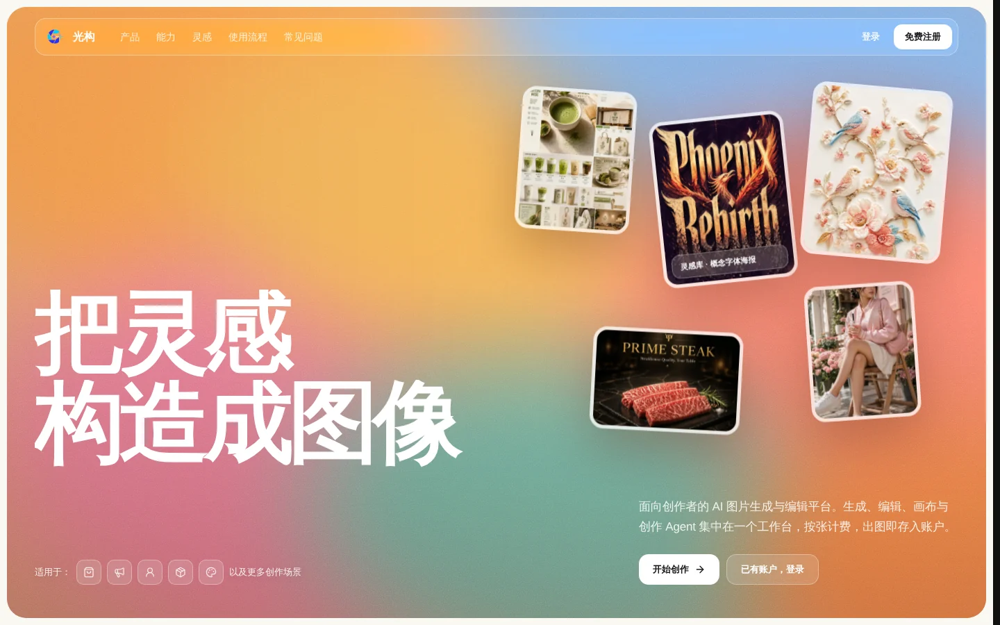

1. 选择“免费注册”，输入用户名（最多 12 个字符）和密码（8–20 位）。运营方开启邮箱验证或人机验证时，按页面提示完成。
2. 注册成功后进入创作空间。运营方可设置新用户赠送积分。
3. 已有账户选择“登录”。

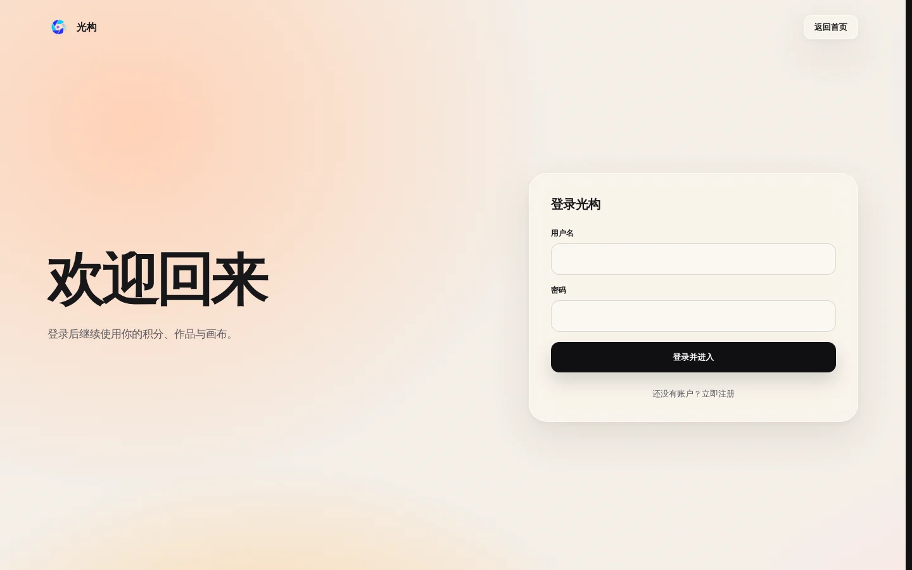

- 运营方关闭注册时，点“免费注册”会显示“暂未开放注册”，登录页也不再显示注册链接。
- 运营方暂停账号密码登录时，登录页会给出提示，登录按钮不可用。
- 运营方启用邮箱服务后，可在用户中心绑定邮箱，并通过登录页的“忘记密码”重置密码；未启用时不显示该入口，账号恢复请联系运营方。

登录状态由服务端 Cookie 保持。管理员更换 `SESSION_SECRET` 会使现有会话失效，更换 `USER_TOKEN_SECRET` 会使已有生成令牌失效。遇到“无效的令牌”时，先退出再重新登录。

## 2. 创作空间

登录后进入“创作”页。左侧导航包括创作、我的作品、收藏、灵感库，以及创作会话（Agent）和我的画布；右上角显示可用积分和用户中心入口。

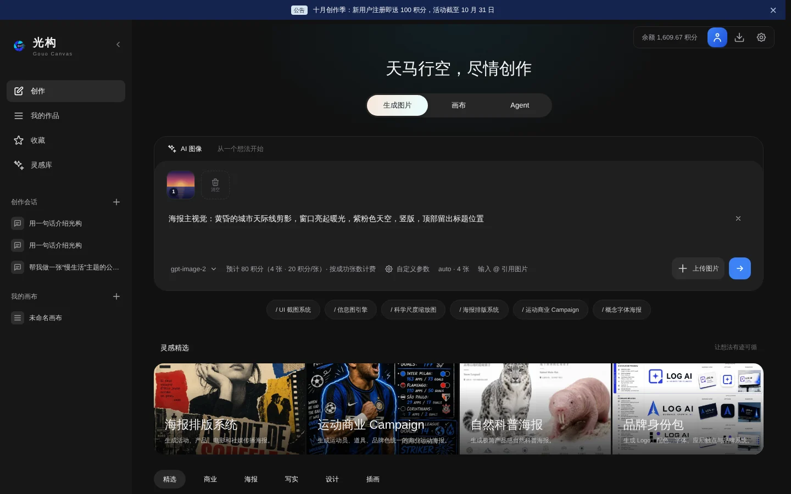

- 页面顶部的横幅显示运营方公告；关闭后，公告内容更新时会再次出现。没有公告时显示默认介绍。
- 中间的“生成图片 / 画布 / Agent”切换三种工作方式；运营方可以关闭画布或 Agent，关闭后对应入口不再显示。
- 输入框下方依次是模型、预计扣费、参数和参考图入口。

## 3. 完成第一次生成

1. 在输入框描述主体、场景、构图、光线和限制条件。
2. 在模型菜单中选择模型。输入框下方会显示本次预计扣费，例如“预计 20 积分（1 张 · 20 积分/张）· 按成功张数计费”。
3. 按需在“自定义参数”中设置尺寸、质量、格式和张数（一次最多 10 张，运营方可调低上限）。
4. 可选：上传参考图，或为参考图绘制遮罩。
5. 点击右侧箭头提交。生成结果出现在输入框下方的“本次生成”，同时进入“我的作品”。

提交前客户端会核对余额，不足时不创建任务，并打开兑换页。请求开始时服务端预扣积分，确认失败的张数会退回。一次生成多张会拆成多个单图请求，按成功张数计费。

模型选择按账号记忆。运营方可设置默认模型，未手动选择过模型的用户会自动使用它；所选模型下架时也会回到默认模型。所选模型不支持参考图或遮罩时会阻止提交。模型价格或能力变化时，界面会要求重新确认；历史任务重试固定原模型，价格变化时显示新价格并另行确认。

## 4. 写提示词

清晰的提示词通常包含：

- **主体**：画面中是谁或什么。
- **环境**：主体位于何处，周围有哪些元素。
- **表现形式**：摄影、插画、3D、海报、信息图等。
- **构图**：特写、全身、俯拍、广角、中心构图等。
- **光线与情绪**：柔光、逆光、霓虹、宁静、热烈等。
- **约束**：不要文字、不要水印、保留人物姿势或产品结构等。

示例：

```text
一个透明亚克力音乐播放器，摆放在深色金属桌面上。
高端产品摄影，中心构图，侧面柔光和蓝色边缘光，
背景简洁，不出现文字、品牌标志或水印。
```

提示词应优先描述可见结果。只写“更好看”“更专业”，效果通常不如明确说明材质、视角、色彩和留白。

## 5. 灵感库

左侧导航“灵感库”收录 22 个提示词模板，可以搜索，或按 UI 与界面、图表与信息可视化、海报与排版、商品与电商等分类浏览。创作页下方的“灵感精选”和快捷标签也来自这里。

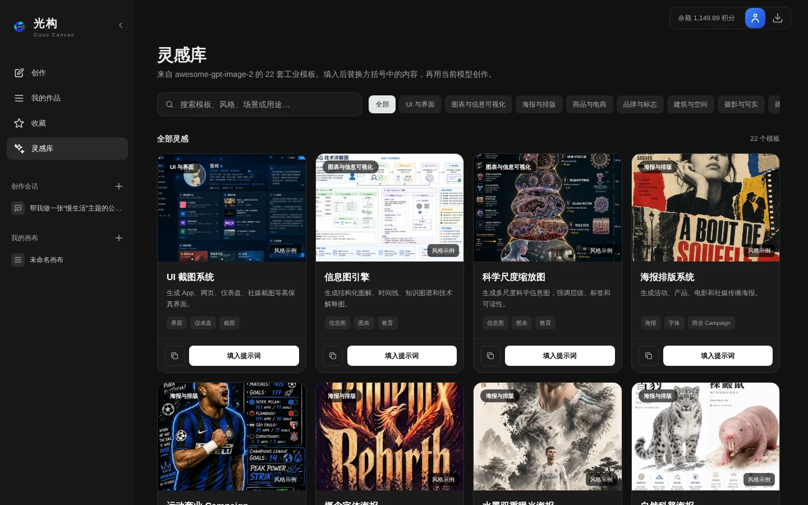

- 点击卡片查看完整提示词、使用建议和示例图来源。
- “填入提示词”会把模板写入创作页输入框，不会立即发送。
- 复制按钮只复制文本，不覆盖当前草稿。
- 模板中的方括号是占位符，替换成自己的主体、品牌、色彩和构图后再提交。示例图保留原作者来源，不代表模板的生成结果。

## 6. 参考图与图片引用

可以通过“上传图片”、拖拽或粘贴添加图片，最多 16 张；实际请求还受上游渠道的数量、格式和大小限制。

- 在提示词中说明每张图的用途，例如“保留图 1 的人物，采用图 2 的配色”。
- 输入 `@` 可选择当前参考图并插入明确引用。
- 桌面端可以拖动缩略图调整顺序，已有图片引用会随之更新。
- 作品卡片上的“编辑输出”会把该作品加入参考图，继续修改。
- 上传前确认自己有权处理图片，不要上传不希望交给平台或上游服务的数据。

参考图不会自动告诉模型要保留什么。希望保留身份、姿势、产品轮廓或构图时，要写进提示词。

## 7. 局部遮罩编辑

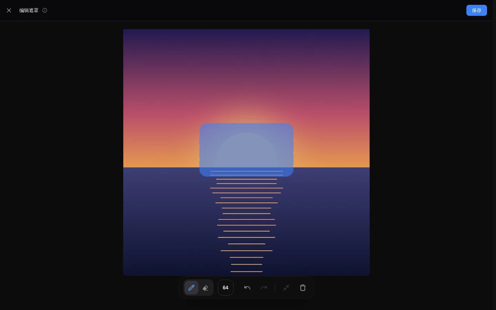

1. 添加一张要修改的图片作为参考图。
2. 点击该参考图的编辑入口，选择“添加遮罩”。可勾选“以后默认执行此选择”，之后不再询问。
3. 在编辑器中用画笔涂抹要改变的区域，蓝色区域即待修改范围。可用橡皮修正、调节笔刷大小、撤销重做或清空遮罩；滚轮缩放，按住 Alt 拖动画布。
4. 点“保存”，并在提示词中写明该区域要变成什么，例如“只把遮罩区域改成红色外套”。
5. 提交编辑请求。

所选模型需要支持遮罩编辑。遮罩覆盖整张图时，界面会提示可能整图重绘，需要确认后再提交。

## 8. 我的作品

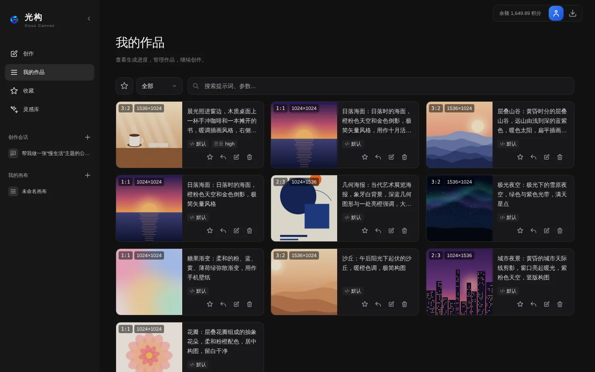

“我的作品”按时间列出全部作品，每页 60 条，支持搜索提示词和参数，并可按状态筛选（全部、已完成、生成中、失败、回收站）。卡片上可收藏、复用配置、编辑输出和删除。

点击图片打开详情，查看完整提示词、实际参数、模型和创建时间，也可以下载、复用配置、编辑输出或删除。

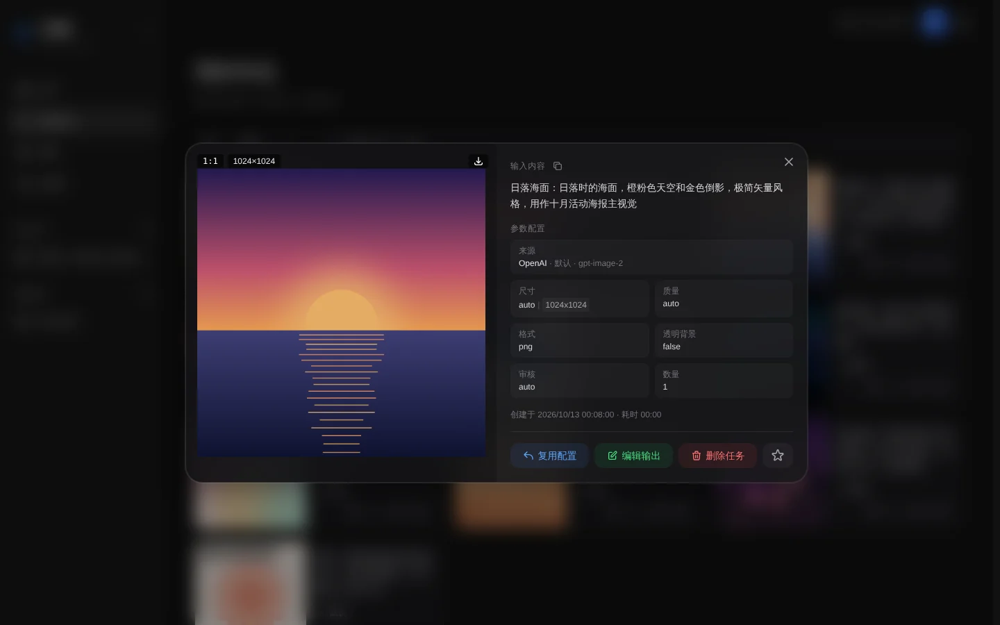

桌面端支持框选和 `Ctrl`/`⌘` 多选，移动端支持多选操作，可批量下载、收藏或删除。切换搜索或筛选会回到第一页，跨页选择会保留。

## 9. 收藏

- 同一个作品可以加入多个收藏夹。
- 收藏页支持搜索、管理收藏夹和批量下载。
- 删除收藏夹不会删除其中的作品。
- 收藏夹及其中的作品关联随账号同步；改名和删除同样同步，旧设备重新连接后不会把已删除的收藏夹重新建回来。

## 10. 画布

“画布”用于把图片、文字和生成配置组织在一张无限画布上，适合做方案和多轮修改。左侧“我的画布”列出全部画布，点“+”新建。

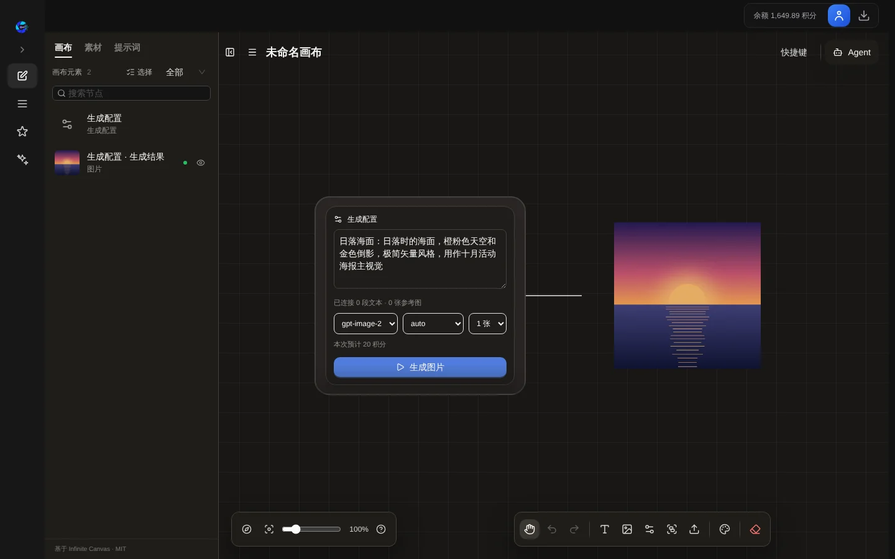

- 底部工具栏可添加文本、图片、生成配置和组节点，上传素材，调整画布外观或清空画布；左下角可缩放、重置视图和打开小地图。
- 生成配置节点填写提示词、选择模型、尺寸和张数，节点内显示本次预计扣费。点“生成图片”后，结果作为新的图片节点连在右侧。连入的文本和图片节点会作为补充提示词和参考图。
- 左侧面板的“画布 / 素材 / 提示词”可浏览节点、已有作品和提示词。
- 右上角“Agent”打开关联当前画布的对话，可让 Agent 读取并整理画布。
- 画布保存到账号，换设备后可继续编辑；删除的画布进入回收站。

## 11. Agent

Agent 是对话式创作助手：描述需求后，它会给出构思，并在需要时调用图片生成、读取或修改关联画布等工具。

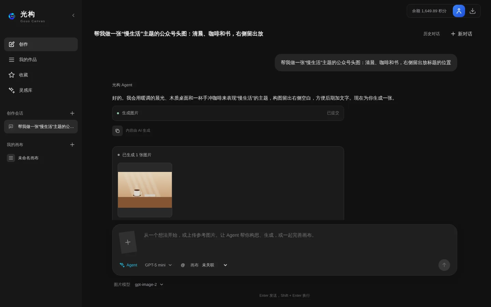

- 输入框下方可选择对话模型（由运营方配置）和图片模型，并可关联一张画布；“+”可添加参考图，也可选择已有作品作为参考。
- `Enter` 发送，`Shift + Enter` 换行。生成中可以停止回复。
- Agent 提交的图片任务按所选图片模型的价格计费，同样出现在“我的作品”。单条消息累计超过 4 张图片时会先请你确认；对话本身按平台文本用量计费。
- 左侧“创作会话”保存历史对话，右上角可新建对话或查看历史。会话随账号同步。

### 技能

技能是写给 Agent 的创作方法说明，例如生图提示词写法、参考图编辑、产品图与电商图、海报设计、角色一致性、图内文字、Logo 与品牌、配色主题。

- Agent 会根据你的需求自动启用合适的技能；也可以点输入框下方的“技能”手动选择，或在消息里输入 `$名称`（例如 `$poster-design`）。启用后在本会话内持续生效，每个会话最多同时启用 4 个，可在输入框上方移除。
- “设置 → 技能”列出内置和导入的技能，可以查看内容、启用或停用、导出为压缩包。
- **导入**：支持技能目录（选择文件夹）、它的 `.zip` / `.skill` 压缩包或单个 `SKILL.md`，格式与社区通行的 Agent Skills 规范一致。导入前会预览来源、许可和文件；与已有技能重名时可选择替换、另存为副本或跳过。管理员（运营方开放后所有用户）还可以粘贴 GitHub 链接（仓库、`tree/` 目录或 `blob/…/SKILL.md`）直接导入，只支持公开仓库，导入时按当时的 commit 固定版本。
- 只保存文本文件：单个文件不超过 1 MB，每个技能合计不超过 2 MB；`scripts/` 中的脚本只记录路径，不会执行，图片等其他文件会被忽略。
- 导入的技能随账号同步，占用云端空间；删除后不能在界面上恢复，服务端按回收站保留期彻底清除。停用内置技能只保存在当前浏览器。
- 导入的技能来自第三方，Agent 只把它当作参考说明，不能改变计费确认和安全规则。请只导入可信来源的技能。

## 12. 云端作品与回收站

登录后，生成成功的图片在出图时由服务端直接保存到账号，浏览器只做缓存；失败的任务不上云。收藏夹、画布和 Agent 会话也随账号保存。

- 换浏览器或设备后，登录同一账号即可看到已保存的内容。
- 网络中断时，已缓存的作品仍可查看。
- 本机旧作品和从 ZIP 导入的作品不会自动上传，需要在“用户中心 → 导入本机旧作品”手动导入；导入完成前清理站点数据会丢失这些作品。
- 删除的作品、画布和会话进入回收站，可在作品列表筛选菜单的“回收站”恢复，期间仍占用云端空间。

回收站内容默认保留 3 天（以界面提示为准，运营方可调整），到期后连同不再使用的图片一起彻底删除，无法找回。

## 13. 积分、兑换码与记录

光构统一使用积分计费，**1 元 = 100 积分**。余额、模型单价、预计扣费、使用记录和导出的 CSV 都以积分显示。

点击右上角的余额或头像打开用户中心：

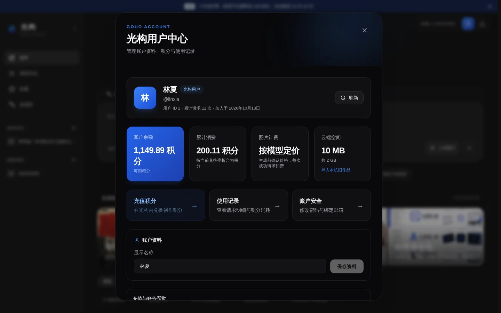

- **账户余额**：当前可用积分。
- **累计消费**：已消耗的积分（按当前兑换率折合）。
- **图片计费**：按模型定价，生成前确认价格，每次成功请求扣费。
- **云端空间**：已用空间和上限，以及“导入本机旧作品”入口。

“充值积分”中输入兑换码即可到账，页面会显示运营方填写的兑换码获取方式。底部“充值与账务帮助”提供客服联系方式。

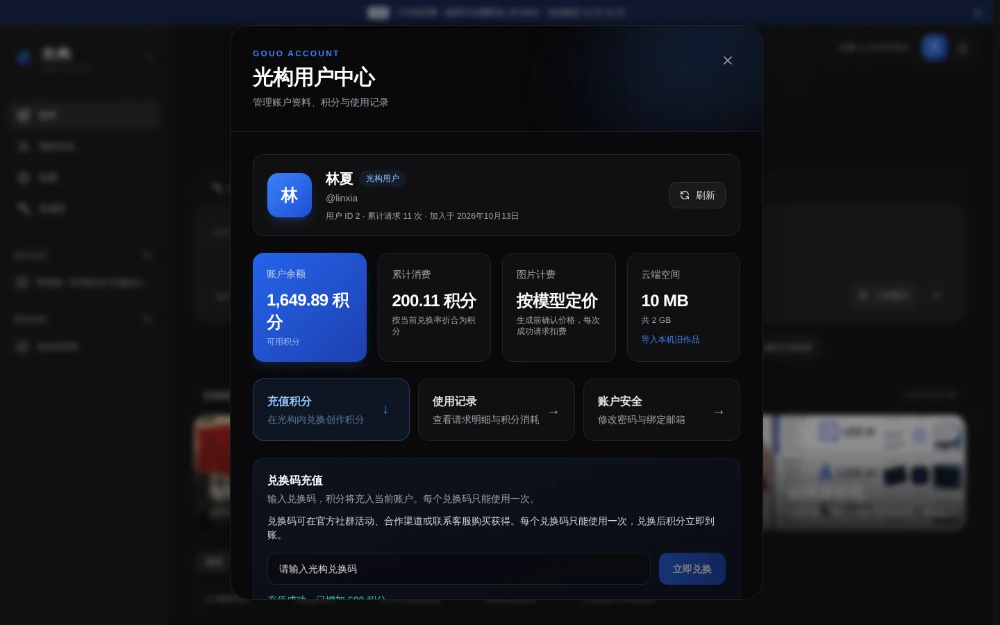

“使用记录”列出积分充值、积分调整、图片生成和模型消费明细，可按类型、模型和日期筛选，也可导出 CSV。

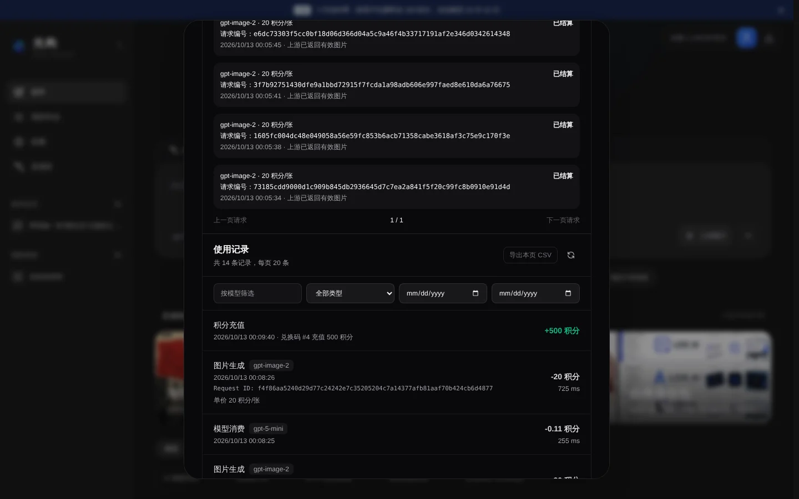

每张成功生成的图片按模型单价扣费，失败的张数由服务端确认后退回。使用记录和 CSV 保留每笔扣费时的单价。若运营方尚未开放在线支付，请使用运营方提供的兑换码。

## 14. 导入与导出

公开产品模式不显示 API Key 和服务商配置，普通用户不需要填写平台密钥。

点击右上角的齿轮图标打开设置，可调整提交快捷键、参考图编辑方式等习惯配置；ZIP 备份的导出、导入和本地数据清理位于“数据管理”。导出时会先补取云端原图，缺图会提示失败；导入时先检查版本、任务引用和图片文件，再一起保存新增任务和图片。相同 ID 的本地任务保留现有记录；图片 ID 相同但内容不同时，整批拒绝导入。

导入的作品不会自动上传，需要在“用户中心 → 导入本机旧作品”手动导入到账号，重复导入可能产生副本。清理本地数据不会删除账号里的云端作品，之后会重新从云端加载；尚未导入账号且未备份的内容会丢失。

## 15. 安装为应用

支持 PWA 的浏览器会在右上角显示“安装为应用”按钮。iPhone/iPad 上可使用 Safari 的“分享 → 添加到主屏幕”。浏览器未提供安装事件时，界面会显示对应平台的手动步骤。

## 16. 常见问题

### 提示“无效的令牌”或 HTTP 401

退出后重新登录。如果持续出现，管理员可能更换了令牌密钥或重置了账号令牌。

### 积分不足

提交前客户端会核对余额，不足时直接打开兑换页。使用有效兑换码充值后，点击任务上的“重试”。

### 请求被安全系统拒绝

删除可能涉及色情、暴力、违法、侵权或敏感身份的内容后重试。向运营方反馈时附上错误中的请求编号，但不要公开密码、Cookie 或完整令牌。

### 图片上传失败

尝试换用 PNG、JPEG 或 WebP，减少图片数量或文件大小。使用遮罩时，确保遮罩主图仍在参考图列表中。

### 请求超时或生成失败

没有返回图片的请求会自动退回积分，可在“用户中心 → 使用记录”的积分明细中查看。重试会新建付费请求。

### 生成成功但换设备后看不到

确认登录的是同一个账号，并在原浏览器确认同步完成。只有已保存到云端的作品才能跨设备查看。

### 页面没有 API 配置

这是预期行为。平台统一管理上游 API，用户不接触平台 API Key，只需登录并在输入框选择图片模型。

## 17. 数据与隐私

生产模式下，账号、积分、使用记录和已同步作品由服务端保存，浏览器只保存缓存。生成或编辑时，提示词和必要的图片会发送给光构后端以及管理员配置的上游模型服务。运营方应公开用户协议、隐私政策、内容规则、数据保留周期、退款说明和侵权投诉渠道。
